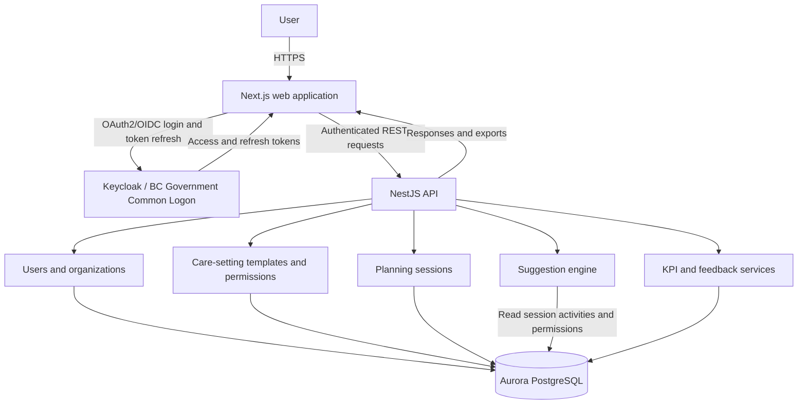

# Architecture Diagrams

## Application Data Flow

The application data flow shows logical application interactions. The API
validates tokens and resolves user roles before coordinating care-setting
management, planning sessions, suggestions, KPI queries, and feedback
persistence through the database.

The network topology is documented separately in
[Network Diagram](./network-diagram.md).
