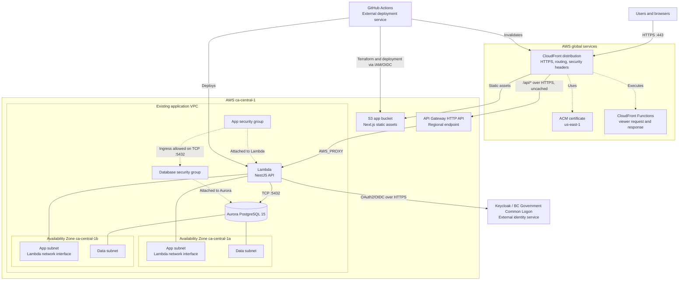

# Network Diagram

The deployed AWS resources use `ca-central-1` by default. The CloudFront
distribution is global; its ACM certificate is managed in `us-east-1`.

CloudFront serves the S3-hosted web application and forwards `/api/*`
requests to the regional API Gateway endpoint. The Lambda function is attached
to the existing app subnets in the VPC and accesses Aurora in the data
subnets. The database security group permits PostgreSQL traffic from the app
security group.

The Terraform configuration does not define the VPC, route tables, NAT
gateways, or subnet resources. Those resources are discovered by name, so
this diagram does not infer routes or internet egress paths that are not
present in the repository.
